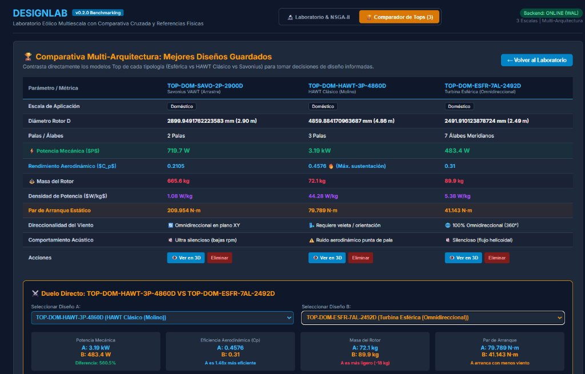
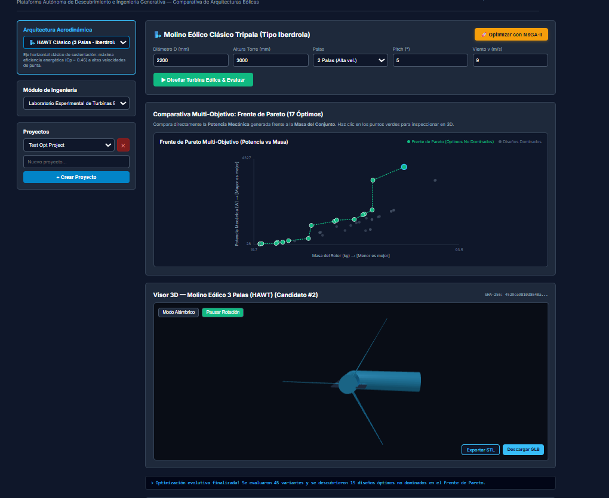
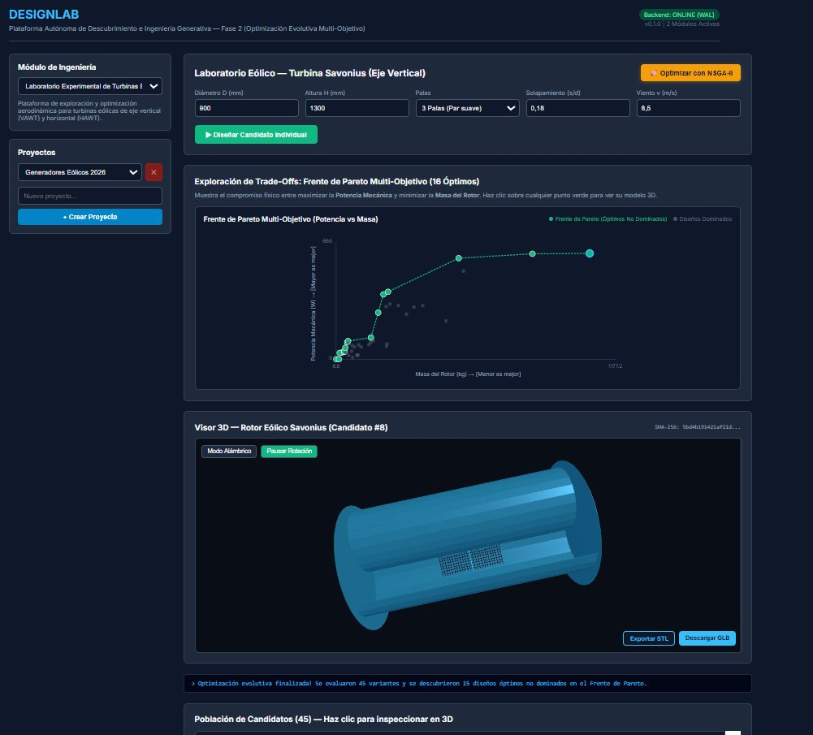

# OptimizerLab (DesignLab)

Plataforma de descubrimiento e ingeniería generativa autónoma diseñada para explorar, optimizar y validar diseños físicos complejos mediante modelos analíticos rápidos, simulaciones híbridas y algoritmos genéticos multi-objetivo (NSGA-II).

---

## 📸 Capturas de la Plataforma

### 1. Comparativa Multi-Arquitectura y Banco de Tops
Matriz de decisión multicriterio y modo duelo directo "Versus (A vs B)" contrastando los mejores diseños guardados (*Savonius VAWT* vs *HAWT Clásico* vs *Turbina Esférica*):



### 2. Laboratorio de Diseño, Optimización NSGA-II y Frente de Pareto
Exploración de compromisos de ingeniería (Potencia Mecánica vs Masa del Rotor) con selector de intentos de optimización (30, 60, 120 variantes) y visor 3D interactivo:


### 3. Modelos 3D y Referencia de Escala Humana (1.75 m)
Visualización WebGL (Three.js) con cotas físicas reales ($D$, $H$, $A$, masa) y silueta humana de referencia:

| Turbina Esférica Omnidireccional | Molino Eólico Clásico (HAWT) | Rotor Savonius (Arrastre) |
|:---:|:---:|:---:|
|  |  |  |

---

## 🚀 Características Principales

- **Arquitectura Desacoplada (`EngineeringModule`):** El núcleo de simulación, la cola de jobs y la base de datos son completamente agnósticos al dominio físico.
- **Optimización Evolutiva Multi-Objetivo:** Algoritmo genético NSGA-II con muestreo Latin Hypercube (LHS), cruce SBX, mutación polinomial y exploración libre con semilla dinámica.
- **Pipeline Geométrico Robusto:** Generación procedural de mallas con Trimesh, verificación de estanqueidad (manifold/watertight), persistencia indexada por hash SHA-256 y exportación en formato `.stl` y `.glb`.
- **Visor 3D Interactivo (Three.js):** Controles orbitales, modo alámbrico/sólido, rotación automática, referencia humana de $1.75\text{ m}$ y HUD con dimensiones reales.
- **Base de Datos Persistente con Tolerancia a Fallos:** SQLite 2.0 en modo WAL (`journal_mode=WAL`) con cola de tareas persistente y recuperación automática de jobs huérfanos tras caídas.
- **Diseñado para Hardware Convencional:** Eficiente en CPU estándar (ej. Intel Core i5, 8 GB RAM, gráficos integrados) sin requerir GPU dedicada ni CUDA obligatorio.

---

## 🛠️ Estructura del Proyecto

- `backend/`: API REST en FastAPI, motor de experimentos, optimización evolutiva y cola de workers.
- `frontend/`: Interfaz de usuario reactiva en React 19, TypeScript, Vite y Three.js.
- `modules/`: Módulos de física e ingeniería conectables (`wind_turbines`, `test_module`).
- `storage/`: Almacén de geometrías pesadas (STL/GLB) indexadas por hash y base de datos SQLite WAL.
- `docs/`: Documentación técnica de arquitectura, dependencias, simulación y capturas de pantalla (`docs/screenshots/`).
- `tests/`: Batería de pruebas automatizadas con `pytest`.

---

## 💻 Inicio Rápido

### Requisitos
- Python 3.11+
- Node.js 18+ con npm

### Backend
```bash
# Crear y activar entorno virtual
python -m venv .venv
.\.venv\Scripts\activate  # En Windows

# Instalar dependencias
pip install -e .

# Iniciar servidor FastAPI
python -m uvicorn backend.main:app --host 127.0.0.1 --port 8000
```

### Frontend
```bash
cd frontend
npm install
npm run dev
```

Abra su navegador en `http://localhost:5173`.
