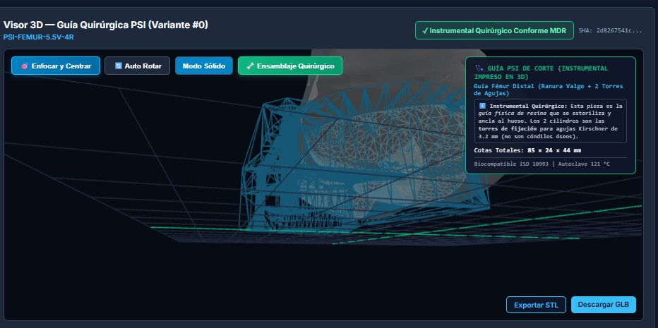
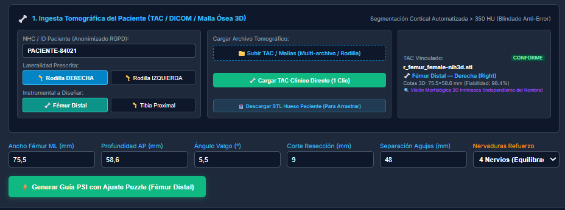
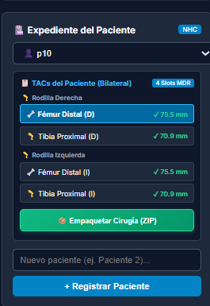
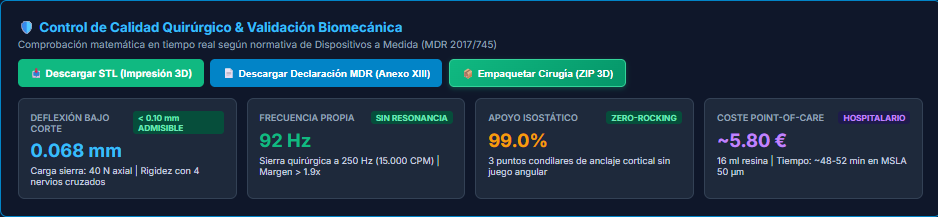
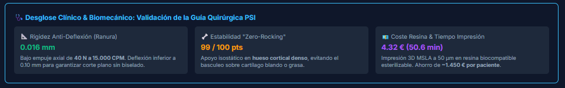
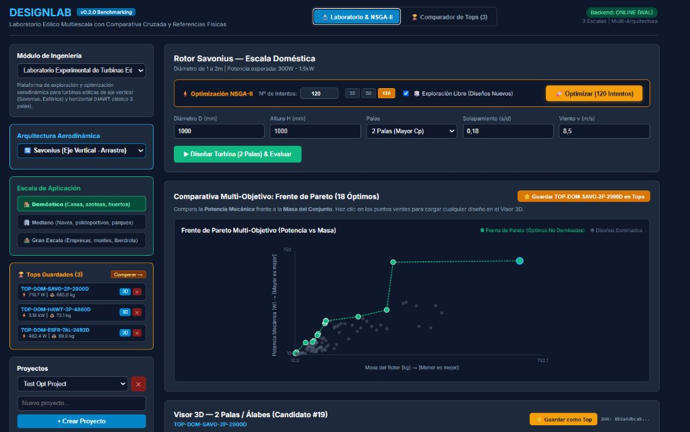
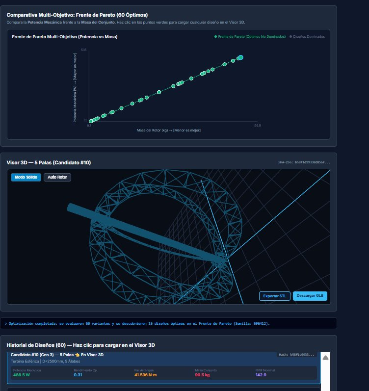

# OptimizerLab (DesignLab) — v0.3.0

Plataforma modular de ingeniería generativa y diseño quirúrgico personalizado (*Point-of-Care*) diseñada para generar, validar y empaquetar piezas e instrumental médico a medida sobre hardware convencional, combinando geometría booleana conformal (`manifold3d`), visión morfológica 3D y optimización evolutiva multi-objetivo (NSGA-II).

---

## 🩺 Módulo Principal: Laboratorio Quirúrgico PSI (Traumatología de Rodilla)

Diseño determinista submilimétrico de **Guías de Corte Específicas de Paciente (PSI)** para artroplastia de rodilla (Fémur Distal *Zero-Rocking* y Tibia Proximal con *Slope* ajustable), cumpliendo con los requisitos de trazabilidad del reglamento **MDR 2017/745 Anexo XIII**.

### 1. Visor 3D en Modo Ensamblaje (*Ghost Bone* + Vaciado Conformal)
Sustracción booleana 3D directa contra el TAC del paciente (con holgura cortical de periostio de $0.15\text{ mm}$), ranura pasante orientada al ángulo de corte y túneles para agujas Kirschner de $3.2\text{ mm}$:



### 2. Ingesta Tomográfica Multi-Archivo y Visión Morfológica 3D
Clasificación intrínseca automática (Fémur vs Tibia, Derecha vs Izquierda, independiente del nombre de archivo), soporte multi-archivo y **partición automática de TACs compuestos** de rodilla completa:



### 3. Expediente Bilateral (4 Slots MDR) y Empaquetado Quirúrgico (ZIP 3D)
Control anti-error de integridad anatómica (bloqueo de duplicados del mismo hueso/lado y alertas de asimetría bilateral) + descarga en 1 clic de todos los STLs listos para impresora MSLA junto con el informe `INSPECCION_Y_TRAZABILIDAD_MDR.txt`:

| Expediente Bilateral del Paciente | Control de Calidad y Exportación MDR |
|:---:|:---:|
|  |  |

### 4. Desglose Clínico y Validación Biomecánica en Tiempo Real
Cálculo estructural instantáneo de deflexión bajo empuje de sierra ($< 0.10\text{ mm}$ a $40\text{ N}$ / $15.000\text{ CPM}$), margen frente a resonancia, estabilidad isostática y coste de resina biocompatible ISO 10993:



---

## 🌬️ Segundo Dominio: Laboratorio Eólico Multiescala (NSGA-II)

### 1. Comparativa Multi-Arquitectura y Banco de Tops
Matriz de decisión multicriterio y modo duelo directo "Versus (A vs B)" contrastando los mejores diseños guardados (*Savonius VAWT* vs *HAWT Clásico* vs *Turbina Esférica*):


### 2. Laboratorio de Diseño, Optimización NSGA-II y Frente de Pareto
Exploración de compromisos de ingeniería (Potencia Mecánica vs Masa del Rotor) con selector de intentos de optimización (30, 60, 120 variantes) y visor 3D interactivo:



### 3. Modelos 3D y Referencia de Escala Humana (1.75 m)
Visualización WebGL (Three.js) con cotas físicas reales ($D$, $H$, $A$, masa) y silueta humana de referencia:

| Turbina Esférica Omnidireccional | Molino Eólico Clásico (HAWT) | Rotor Savonius (Arrastre) |
|:---:|:---:|:---:|
|  |  |  |

---

## 🚀 Características Principales

- **Arquitectura Desacoplada (`EngineeringModule`):** El núcleo de simulación, la cola de jobs y la base de datos son completamente agnósticos al dominio físico.
- **Amoldado Anatómico Conformal (`manifold3d` + `trimesh`):** Operaciones booleanas estancas (*watertight*) en milisegundos, grabado 3D indeleble en la propia pieza y exportación directa en `.stl`, `.glb` y packs `.zip`.
- **Optimización Evolutiva Multi-Objetivo:** Algoritmo genético NSGA-II con muestreo Latin Hypercube (LHS), cruce SBX, mutación polinomial y exploración libre con semilla dinámica.
- **Visor 3D Interactivo (Three.js):** Modo ensamblaje (*Ghost Bone*), controles orbitales, modo alámbrico/sólido, rotación automática y HUD con dimensiones reales.
- **Base de Datos Persistente con Tolerancia a Fallos:** SQLite 2.0 en modo WAL (`journal_mode=WAL`) con cola de tareas persistente y recuperación automática de jobs huérfanos tras caídas.
- **Diseñado para Hardware Convencional:** Eficiente en CPU estándar (ej. Intel Core i5, 8 GB RAM, gráficos integrados) sin requerir GPU dedicada ni CUDA obligatorio.

---

## 🛠️ Estructura del Proyecto

- `backend/`: API REST en FastAPI, motor de experimentos, optimización evolutiva y cola de workers.
- `frontend/`: Interfaz de usuario reactiva en React 19, TypeScript, Vite y Three.js.
- `modules/`: Módulos de ingeniería conectables (`traumatology_psi`, `wind_turbines`, `test_module`).
- `storage/`: Almacén de geometrías (STL/GLB) y TACs indexados por hash SHA-256 y base de datos SQLite WAL.
- `docs/`: Documentación técnica de arquitectura, dependencias, simulación y capturas de pantalla (`docs/screenshots/`).
- `tests/`: Batería de pruebas automatizadas con `pytest`.

---

## 💻 Inicio Rápido

### Requisitos
- Python 3.11+
- Node.js 18+ con npm

### Backend
```bash
# Crear y activar entorno virtual
python -m venv .venv
.\.venv\Scripts\activate  # En Windows

# Instalar dependencias
pip install -e .

# Iniciar servidor FastAPI
python -m uvicorn backend.main:app --host 127.0.0.1 --port 8000
```

### Frontend
```bash
cd frontend
npm install
npm run dev
```

Abra su navegador en `http://localhost:5173`.
