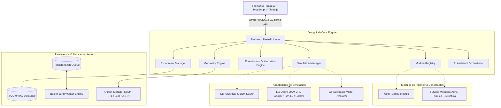

# ARQUITECTURA TÉCNICA DE DESIGNLAB

DesignLab está diseñado como una plataforma de ingeniería generativa modular, escalable, con tipado estricto y desacoplada de cualquier dominio físico particular.

---

## 1. Visión General del Sistema



---

## 2. Subsistemas Principales

### 2.1 Backend (`backend/`)
- **`backend/api/`**: Controladores de endpoints REST para proyectos, experimentos, candidatos, ejecuciones de simulación, geometría y exportación.
- **`backend/core/experiment_manager/`**: Orquesta el ciclo de vida de los experimentos, la transición de generaciones y el guardado atómico de estados.
- **`backend/core/module_registry/`**: Registro dinámico de módulos de ingeniería (`EngineeringModule`). Carga y valida esquemas sin acoplar el backend a una disciplina.
- **`backend/core/geometry/`**: Abstracción unificada que soporta tanto sólidos B-Rep (build123d) como mallas poligonales (Trimesh), exportadores y validadores de integridad topológica.
- **`backend/core/simulation/`**: Registro de adaptadores de simulación clasificados por fidelidad (L1 rápido, L2 avanzado, L3 subrogado).
- **`backend/core/optimization/`**: Orquestador evolutivo basado en Pareto (pymoo) con operadores genéticos y preservación de diversidad.
- **`backend/core/ai/`**: Proveedor desacoplado de sugerencias de IA con validación estricta de esquemas Pydantic y cero ejecución de código dinámico.
- **`backend/workers/`**: Motor de cola persistente para tareas en segundo plano con control de memoria y tolerancia a fallos.
- **`backend/database/`**: Modelos SQLAlchemy y sesiones SQLite con configuración WAL.

### 2.2 Frontend (`frontend/`)
- **`src/components/viewer3d/`**: Visor 3D interactivo con controles de órbita, corte, visualización de malla alámbrica y renderizado de geometrías.
- **`src/components/experiments/`**: Asistente de configuración de experimentos (selección de módulo, familia, parámetros, objetivos, restricciones y límites).
- **`src/components/optimization/`**: Gráficos interactivos de frentes de Pareto 2D/3D, dispersión de candidatos y evolución a través de generaciones.
- **`src/components/editor/`**: Inspección y ajuste manual de parámetros de candidatos con regeneración en tiempo real.
- **`src/components/simulations/`**: Monitor de trabajos de simulación, logs en streaming, estado de convergencia y errores.
- **`src/components/dashboard/`**: Panel general de proyectos, métricas del sistema y acceso rápido a candidatos destacados.

---

## 3. Flujo del Ciclo de Vida de un Candidato

```mermaid
sequenceDiagram
    autonumber
    actor User as Usuario / Bucle Autónomo
    participant Exp as Experiment Manager
    participant Opt as Optimization Engine
    participant Geom as Geometry Engine
    participant Sim as Simulation Engine
    participant DB as SQLite DB & Storage

    User->>Exp: Iniciar Experimento
    Exp->>Opt: Generar Población Inicial (Muestreo LHS)
    loop Para cada Candidato en Población
        Opt->>Geom: Generar Geometría (Paramétrica / Malla)
        Geom->>Geom: Validar Manifoldness & Solidez
        alt Geometría Inválida
            Geom-->>Exp: Rechazo con Causa Registrada
        else Geometría Válida
            Geom->>DB: Guardar Artefactos (STEP, STL, GLB)
            Exp->>Sim: Evaluar Nivel 1 (Analítico / Rápido)
            Sim-->>Exp: Métricas (Potencia, Eficiencia, Masa)
            DB->>DB: Persistir Candidato & Métricas
        end
    end
    Exp->>Opt: Calcular Frente de Pareto & Seleccionar Finalistas
    opt Si hay presupuesto computacional
        Exp->>Sim: Ejecutar Nivel 2 en Finalistas (CFD Asíncrono)
        Sim-->>Exp: Resultados de Alta Fidelidad
    end
    Exp->>Opt: Operadores Evolutivos (Cruce, Mutación) -> Nueva Generación
```

---

## 4. Persistencia y Resiliencia ante Fallos (Crash Recovery)

- Toda tarea o simulación que requiere más de unos cientos de milisegundos se encola en la tabla `jobs` de SQLite con estado inicial `PENDING`.
- Al tomar una tarea, un worker actualiza el estado a `RUNNING` junto con un timestamp de latido (`heartbeat_at`).
- **Recuperación tras reinicio:** Al iniciar el backend, el servicio de inicialización escanea la tabla `jobs`. Cualquier trabajo que estuviera marcado como `RUNNING` antes de la interrupción se reanuda o se marca de manera controlada como `FAILED_ORPHANED` con diagnóstico claro, permitiendo al usuario o al optimizador autónomo reintentarlo limpiamente sin corrupción de base de datos.
- **Modo WAL:** La configuración `PRAGMA journal_mode=WAL;` y `PRAGMA busy_timeout=5000;` previene bloqueos de concurrencia entre lecturas de la API y escrituras de los workers.
