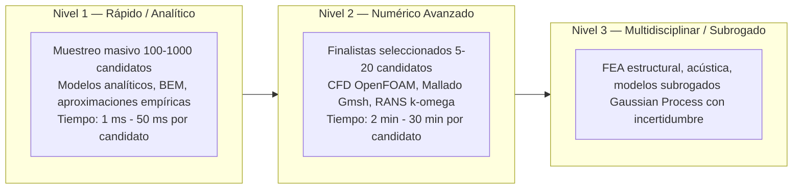

# MOTOR DE SIMULACIÓN Y ADAPTADORES DE FIDELIDAD

DesignLab adopta una arquitectura de evaluación híbrida y transparente que clasifica cada cálculo por su nivel de fidelidad computacional.

---

## 1. Niveles de Fidelidad de Simulación



### Regla Fundamental de Transparencia
- **Nunca presentar un resultado aproximado como simulación de alta fidelidad.**
- Cada evaluación almacena:
  - `fidelity_level`: `LEVEL_1_ANALYTICAL`, `LEVEL_2_CFD`, `LEVEL_3_SURROGATE`.
  - `solver_name` y `solver_version`.
  - `convergence_status`: `CONVERGED`, `NOT_CONVERGED`, `ESTIMATED`.
  - `execution_time_seconds`.
  - `uncertainty_estimate`: estimación de error numérico cuando esté disponible.

---

## 2. Contrato de Adaptador de Simulación

```python
from abc import ABC, abstractmethod
from typing import Any
from pydantic import BaseModel

class SimulationConfig(BaseModel):
    solver: str
    timeout_seconds: int = 300
    max_memory_mb: int = 2048
    cores_allocated: int = 2
    mesh_resolution: str = "medium"

class SimulationAdapter(ABC):
    """Interfaz abstracta para motores de simulación externos o internos."""

    @abstractmethod
    def is_available(self) -> tuple[bool, str]:
        """Comprueba si el solver o entorno requerido está instalado y accesible."""
        pass

    @abstractmethod
    def prepare_case(self, case_dir: str, geometry_path: str, conditions: dict[str, Any]) -> None:
        """Genera los archivos de entrada requeridos por el solver."""
        pass

    @abstractmethod
    def run_simulation(self, case_dir: str, config: SimulationConfig) -> dict[str, Any]:
        """Ejecuta el solver y recopila resultados, métricas de convergencia y logs."""
        pass
```

---

## 3. Adaptador OpenFOAM (Aislamiento y Mitigación)

- Diseñado para ejecutarse en entornos compatibles con Linux (WSL2 o contenedor Docker).
- En máquinas Windows con 8 GB de RAM sin WSL2 instalado:
  - El sistema detecta la ausencia del solver mediante `is_available()`.
  - La interfaz de usuario muestra el estado del adaptador como "Inactivo / Requiere WSL2 o Docker".
  - Se incluye un adaptador simulador para pruebas del pipeline de integración sin bloquear el desarrollo ni las pruebas de regresión.
